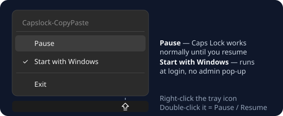
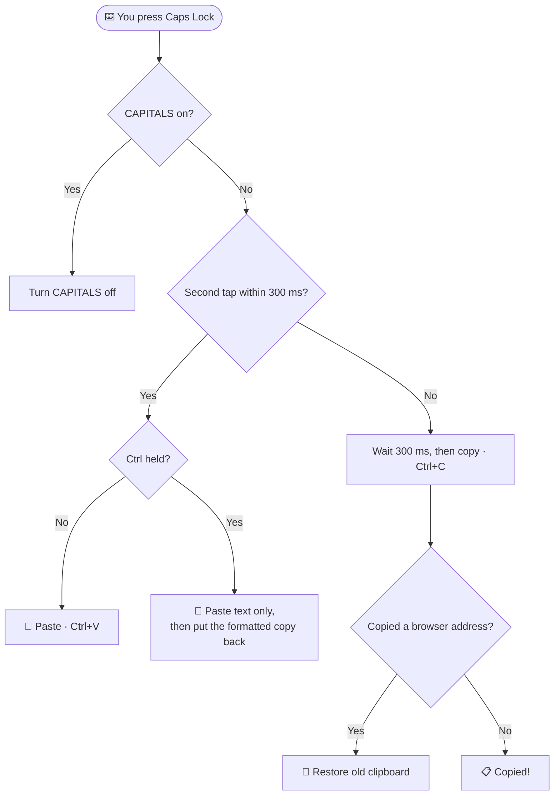

# 🔤 Capslock-CopyPaste by MOGDHO PAUL


**Turn the useless `Caps Lock` key into Copy & Paste.** Tap once to copy, tap twice to paste. That's it.

**⬇️ Download and setup guide: [mogdhopaul.com/capslock-copypaste](https://mogdhopaul.com/capslock-copypaste/)**

<p align="center">
  
</p>

---

## ⌨️ Controls

| You press | What happens | You see |
|:--|:--|:--|
| `Caps Lock` **once** | 📋 Copies what you selected | **📋 Copied!** |
| `Caps Lock` **twice quickly** | 📌 Pastes | **📌 Pasted!** |
| `Ctrl` + `Caps Lock` **twice quickly** | 📝 Pastes as **plain text**: no fonts, colors or links | **📝 Pasted as plain text!** |
| `Shift` + `Caps Lock` | 🔠 Turns normal CAPITALS on/off | — |
| `Caps Lock` while CAPITALS are on | Turns CAPITALS off (no copy/paste) | — |

> 💡 Works with **text, images and files** — anything `Ctrl+C` / `Ctrl+V` can handle.
>
> 📝 **Plain-text paste** is great for copying from a website into Word, Gmail or Outlook without bringing the website's fonts along. Your formatted copy stays on the clipboard for next time.

### 💬 The little pop-ups

A small tooltip appears next to your mouse and disappears by itself:

| Pop-up | Meaning |
|:--|:--|
| **📋 Copied!** | ✅ Copy worked |
| **📌 Pasted!** | ✅ Paste worked |
| **📝 Pasted as plain text!** | ✅ Plain-text paste worked |
| **🚫 Blocked!** | ⚠️ You copied a browser address like `chrome://newtab`, so your old clipboard was kept |
| **❌ Nothing copied!** | Nothing was selected, so your old clipboard was kept |
| **❌ Nothing to paste!** | The clipboard is empty |
| **❌ No text to paste!** | Plain-text paste, but the clipboard holds only an image or files |

---

## 🚀 Get started

### ⚡ Easiest: download the .exe (no AutoHotkey needed)

```
 ① Download Capslock-CopyPaste.exe   →   ② Double-click it   →   ✅ Tap Caps Lock!
```

1. Go to **[Releases](https://github.com/mogdho/Capslock-CopyPaste/releases/latest)** and download **`Capslock-CopyPaste.exe`**.
2. **Double-click** it and click **Yes** on the admin pop-up.
   An **up-arrow icon** appears in your system tray: the app is running. 🎉

> 🛡️ **"Windows protected your PC"?** The .exe isn't code-signed (that costs money), so Windows SmartScreen may warn you. Click **More info** → **Run anyway**. Don't trust it? Use the script version below and read the code yourself.

### 🛠️ Or run the script with AutoHotkey

1. **Install [AutoHotkey v2](https://www.autohotkey.com/)** (free).
2. **Download** this repository: green **Code** button → **Download ZIP**, then unzip it.
3. **Double-click** `Capslock-CopyPaste.ahk` and click **Yes** on the admin pop-up.
   An **up-arrow icon** appears in your system tray: the script is running. 🎉

> **Why admin?** Without it, Windows blocks the shortcut inside apps that run as administrator (Task Manager, installers, admin terminals…).

---

## 🗂️ Tray menu

Right-click the tray icon:

<p align="center">
  
</p>

| Option | What it does |
|:--|:--|
| **Pause** | Caps Lock goes back to normal until you resume. The icon fades. *Tip: double-click the tray icon to pause / resume.* |
| **Start with Windows** | Starts the script automatically when you log in, **with no admin pop-up**. Click again to turn it off. |
| **Exit** | Closes the script. |

> 💡 If you move the script to another folder, just tick **Start with Windows** again.

---

## 🧠 How it works



**Smart details**

- 🛡️ **Your clipboard is protected.** The old clipboard (text, images, files, formatting) is saved first. If the copy fails or is blocked, it's put back.
- 🚫 **Blocked addresses:** text that *starts with* `about:blank`, `about:newtab`, `chrome://`, `edge://`, `brave://`, `opera://`, `vivaldi://` or `firefox:`. These usually come from accidentally copying an empty browser tab.
- ✋ **Holding** `Caps Lock` does nothing extra: no repeated pasting.
- 🎯 **Tapping 3 times** pastes once, not twice.
- ⏱️ **Want faster copying?** Open the script and lower `DoubleTapMs := 300` (e.g. `250`). Lower = faster copy, but you'll need to double-tap faster.

---

## ❓ Troubleshooting

| Problem | Fix |
|:--|:--|
| Nothing happens | Check the up-arrow tray icon is there and not faded (paused). Make sure you installed AutoHotkey **v2**, not v1. |
| Doesn't work in Task Manager / admin apps | The script must run as admin: click **Yes** on the pop-up, or tick **Start with Windows**. |
| Double-tap copies instead of pasting | Tap faster, or raise `DoubleTapMs` a little (e.g. `350`). |
| I need real Caps Lock | Press `Shift + Caps Lock`, or **Pause** the script. |

---

## 🗑️ Uninstall

1. Right-click the tray icon → **untick Start with Windows** *(removes its startup task)*.
2. Right-click the tray icon → **Exit**.
3. Delete `Capslock-CopyPaste.exe` / `.ahk`.

> ⚠️ **Already deleted it?** The startup task is left behind. Press `Win + R` → `taskschd.msc` → right-click **Capslock-CopyPaste (AutoHotkey)** → **Delete**.

---

## 📁 Project Structure

```
Capslock-CopyPaste/
├── 📄 Capslock-CopyPaste.ahk   ← The script
├── 📁 assets/
│   └── demo.svg / tray.svg   ← Pictures in this README
└── 📖 README.md                ← You are here!
```

---

### 👨‍💻 Author

**Mogdho Paul**

🔗 GitHub: [github.com/mogdho](https://github.com/mogdho)
📂 Source: [Capslock-CopyPaste](https://github.com/mogdho/Capslock-CopyPaste)
